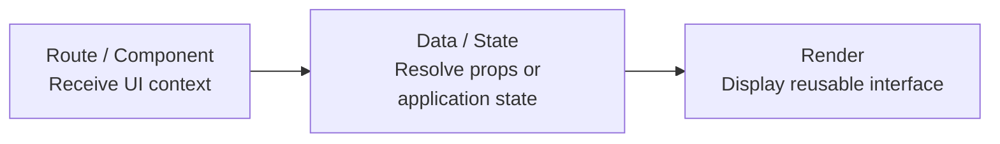

# NextJS shadcn Dashboared

**Portfolio project** · A Next.js dashboard interface using reusable components and a modern app-router structure.

## Overview

A Next.js dashboard interface using reusable components and a modern app-router structure.

## Technology Stack

- `Node.js`
- `Next.js`
- `React`
- `Tailwind CSS`
- `TypeScript`
- `CSS`

## How the Repository Works

| Stage | Responsibility |
|---|---|
| **Route / Component** | Receive UI context |
| **Data / State** | Resolve props or application state |
| **Render** | Display reusable interface |

## Concepts Covered

- Component-based UI
- State and props
- Event handling
- Reusable layout
- Client-side rendering

## Repository Map

- `.gitignore`
- `app`
- `components`
- `components.json`
- `eslint.config.mjs`
- `hooks`
- `lib`
- `next.config.ts`
- `package-lock.json`
- `package.json`
- `postcss.config.mjs`
- `public`

## Recruiter Summary

This repository demonstrates practical implementation skills, repository organization, and an end-to-end understanding of the project workflow. It is suitable as a focused example of applied software or data work.

---

Documentation is concise and project-focused; source code was not modified.
